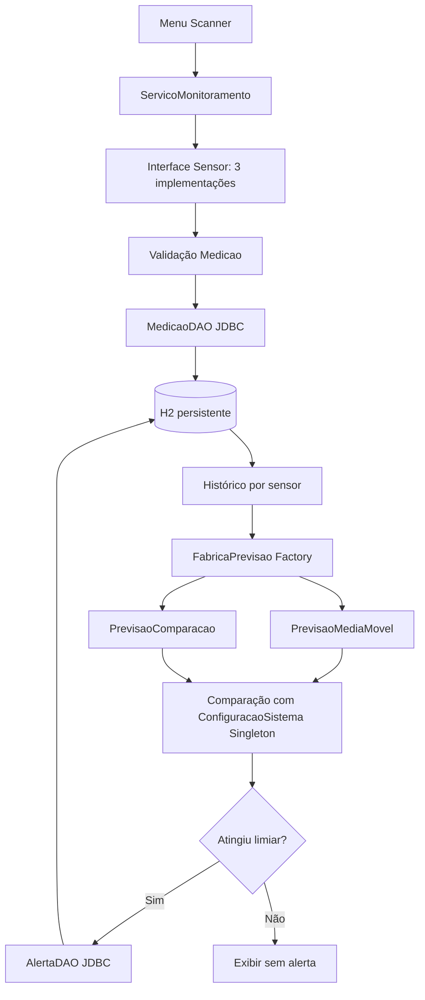

# Global Solution 2º/2026 — Territory Predictive Insights

**Disciplina:** Object-Oriented Programming (OOP) — Turma de fevereiro  
**Tema geral:** CitizenTech  
**Recorte adotado no protótipo:** clima local — chuva intensa e risco de alagamento.  
**Status:** implementação de referência para estudo; requer revisão/autoria do grupo e testes no ambiente da equipe antes da entrega acadêmica.

## Integrantes (preencher antes da entrega)

| Nome completo | RM | Responsabilidade | Link do GitHub/perfil |
|---|---|---|---|
| [Luiz Miguel Martin Crocco] | [RM562796] | Domínio e exceções |
| [Murilo Justino Arcanjo] | [RM565470] | Persistência JDBC/H2 |
| [Enzo Hideki] | [RM565052] | Previsões, alertas e testes |

**Repositório oficial da equipe:** `[INSERIR_URL_DO_GITHUB]`  
**Observação:** os três integrantes devem ter commits reais, com mensagens claras, correspondentes às suas contribuições.

## 1. Problema, público beneficiado e decisão apoiada

Moradores e associações comunitárias de regiões com pontos de alagamento têm dificuldade para acompanhar medições contínuas de chuva, nível de córrego e umidade do solo. Este sistema **simula** sensores de uma região e constrói indicadores simples a partir de leituras armazenadas no banco.

- **Público:** moradores, lideranças de bairro e equipes comunitárias que precisam priorizar inspeções e prevenção.
- **Decisão apoiada:** avaliar quando investigar um ponto, avisar uma equipe responsável ou intensificar a observação de campo.
- **Limitação essencial:** os valores e limiares são **didáticos, não calibrados e não aprovados por órgãos oficiais**. O aplicativo não substitui meteorologia, Defesa Civil, protocolos de emergência ou decisão humana.
- **Privacidade:** não há cadastro de pessoas físicas, CPF, nome ou endereço real. O cadastro trabalha com região e equipamentos fictícios.

## 2. Decisões técnicas da equipe

1. **Java 17 + Maven:** separação de pacotes `dominio`, `excecao`, `persistencia`, `servico` e `util`.
2. **JDBC + H2 em arquivo**, em vez de Spring Boot + JPA: caminho simples, sem necessidade de servidor externo. O banco é criado automaticamente e permanece após reiniciar o programa.
3. **Menu de console via Scanner:** sem interface gráfica e sem API REST, conforme FAQ do enunciado.
4. **Três sensores simulados:** chuva (mm/h), nível de rio (cm) e umidade do solo (%), todos de uma região fictícia.
5. **Duas estratégias:** média das últimas 5 medições e comparação das médias dos últimos 2 grupos de 5 medições.
6. **Alertas ATENCAO/ALERTA/CRITICO:** emitidos ao rodar previsões caso os limiares sejam atingidos e gravados no banco.
7. **Factory real:** `FabricaPrevisao` centraliza instanciação das estratégias mediante `EnumMap` + `Supplier`, sem `instanceof` nem `if` para escolher a estratégia.
8. **Singleton real:** `ConfiguracaoSistema` possui construtor privado e uma instância única com dados/limiares da execução.
9. **Padrão AAA:** testes JUnit com exceções e mocks Mockito; adicionalmente, teste de integração com H2.
10. **Bônus escolhido:** exportação de medições para arquivo CSV (menu 7).

**Atenção:** as configurações de região, população e limiares alteradas no menu não são persistidas; o requisito de persistência abrange **medições e alertas**, e ambos são armazenados. A área e os identificadores dos sensores permanecem fixos na simulação; mudar o nome da região no cadastro não move os sensores.

## 3. Pré-requisitos

- JDK **17 ou superior** (comandos `java -version` e `javac -version`).
- **Apache Maven 3.9+** (`mvn -version`).
- Conexão de internet na **primeira execução** para baixar bibliotecas Maven (H2, JUnit, Mockito).
- Permissão de escrita na pasta do projeto (`data/`, `relatorios/`).

### Rodar no terminal

Na raiz do projeto:

```bash
mvn clean test
mvn exec:java
```

Alternativamente, no IntelliJ IDEA, importe `pom.xml`, faça o reload das dependências Maven e execute `SistemaMonitoramento.main()`.

Se o Maven não estiver instalado, instale-o antes de executar. **Não basta rodar `java SistemaMonitoramento.java`**, porque o driver JDBC H2 precisa estar no classpath.

### Banco de dados

Por padrão, o JDBC usa `jdbc:h2:file:./data/territorio`. Após a primeira execução, o H2 cria `data/territorio.mv.db`, que deve sobreviver ao fechamento do app. O método `BancoDados.inicializar()` cria as tabelas, e há uma cópia legível do DDL em [`sql/schema.sql`](sql/schema.sql).

Para usar uma URL JDBC diferente, configure `TERRITORIO_DB_URL`, por exemplo:

```bash
export TERRITORIO_DB_URL='jdbc:h2:file:./data/territorio'
mvn exec:java
```

**Demonstração de persistência:** execute 6 (10 ciclos), depois 2 (previsões), 3 (histórico), 0 (sair), reinicie com `mvn exec:java` e confirme que o histórico permanece no menu 3.

## 4. Menu e funcionalidades

| Opção | Função |
|---|---|
| `1` | Verificar sensores, simular uma medição por sensor, validar e gravar no H2 |
| `2` | Rodar estratégias em cada sensor, explicar previsão e persistir alertas |
| `3` | Consultar medições por sensor, todas as medições ou alertas emitidos |
| `4` | Inspecionar o território, alterar região/população ou limiares com código |
| `5` | Status consolidado do ponto, sensores e totais persistidos |
| `6` | Gerar 10 ciclos simulados para demonstrar rapidamente as previsões |
| `7` | Exportar medições do histórico para `relatorios/medicoes.csv` |
| `0` | Encerrar sem apagar medições nem alertas |

**Código de demonstração para alteração de limiares:** `DEMO2026`. Para evitar usar um código fixo, exporte a variável `TERRITORIO_CODIGO_ACESSO` antes de iniciar. O valor de demonstração não é uma proteção adequada para produção.

### Intervalos didáticos

| Sensor | Unidade | Intervalo válido da medição | Atenção | Alerta | Crítico |
|---|---|---:|---:|---:|---:|
| Chuva (`CH-01`) | mm/h | 0–120 | 20 | 40 | 70 |
| Nível de rio (`RI-01`) | cm | 0–500 | 150 | 250 | 350 |
| Umidade do solo (`SO-01`) | % | 0–100 | 60 | 75 | 90 |

Valores simulados com `Random` e faixas escolhidas para fins de exercício. **Não representam limites reais de risco de alagamento**.

## 5. Estrutura e arquitetura

```text
.
├── pom.xml
├── README.md
├── CHECKLIST_ENTREGA.md
├── ROTEIRO_DEMONSTRACAO.md
├── INTEGRANTES_E_LINK.txt
├── sql/schema.sql
├── data/LEIA-ME.txt
├── src/main/java/br/edu/fiap/territorio/
│   ├── SistemaMonitoramento.java
│   ├── dominio/    (Sensor, Medicao, Alerta, DTOs, subclasses, previsões)
│   ├── excecao/    (DadosInvalidosException, FonteIndisponivelException)
│   ├── persistencia/ (BancoDados, MedicaoDAO, AlertaDAO)
│   ├── servico/    (ServicoMonitoramento, FabricaPrevisao, ConfiguracaoSistema)
│   └── util/       (ExportadorCsv)
└── src/test/java/br/edu/fiap/territorio/
    ├── dominio/    (validações, estratégias)
    └── servico/    (Factory, Mockito, H2)
```

Fluxo do aplicativo:



### Principais conceitos OOP

- **Abstração:** `ComponenteTerritorial` e `EstrategiaPrevisao` são abstratas.
- **Herança:** `PontoMonitoramento extends ComponenteTerritorial`; duas classes de previsão herdam de `EstrategiaPrevisao` e chamam `super(...)`.
- **Polimorfismo:** `Sensor` possui 3 implementações; a previsão é disparada via contrato `prever()` sem inspeção concreta de tipo.
- **Encapsulamento:** `DadosTerritorio` mantém os atributos privados e exige código para mudar limiares.
- **Exceções:** `DadosInvalidosException` e `FonteIndisponivelException`, com captura informativa no console.
- **Persistência segura:** `PreparedStatement`, consultas parametrizadas, `try-with-resources`.

## 6. Testes

Execute:

```bash
mvn clean test
```

Testes implementados:

1. `MedicaoTest`: aceita valor válido e rejeita chuva negativa (`assertThrows`).
2. `DadosTerritorioTest`: rejeita senha errada, população negativa e aprova alteração autorizada.
3. `PrevisaoMediaMovelTest`: verifica resultado numérico e histórico insuficiente.
4. `PrevisaoComparacaoTest`: compara períodos e verifica projeção numérica.
5. `FabricaPrevisaoTest`: verifica criação de estratégias diferentes.
6. `ServicoMonitoramentoTest`: **Mockito** confirma gravação de alerta crítico e ausência de gravação quando não há risco, sem acessar banco.
7. `BancoDadosIntegracaoTest`: verifica inserção e consulta reais no H2 em memória.

**Qualidade:** se a fórmula de média/projeção for alterada incorretamente, as asserções numéricas devem falhar. Os testes usam AAA (Arrange, Act, Assert).

## 7. Reflexão crítica

**Quando o sistema deve se calar?** Uma previsão não deve ser apresentada como confiável quando não existe histórico suficiente. Por isso, a média móvel exige pelo menos cinco medições por sensor e a comparação exige dez: cinco recentes e cinco anteriores. Se não houver esse mínimo, o sistema não calcula nem emite alerta para aquela estratégia. Mesmo com dez amostras, o resultado continua sendo uma aproximação matemática muito simples. Leituras repetidas em poucos segundos não equivalem à observação de fenômenos climáticos reais ao longo do tempo. Além disso, sensores com falha, valores fora da faixa e falta de comunicação exigem mensagens explícitas, e não um valor inventado ou um `catch` vazio.

**O que os dados não representam?** Uma única estação não descreve a variação de risco em todo o bairro. Chuva, nível de água e umidade são grandezas diferentes; não se deve comparar diretamente seus números nem afirmar que um resultado isolado prova que ocorrerá um alagamento. A simulação também não contempla topografia, drenagem, microbacias, obstruções, previsão meteorológica profissional, equipamentos calibrados ou séries históricas reais. Limiares demonstrativos servem apenas ao aprendizado e não devem ser usados como gatilhos operacionais.

**Por que o alerta apoia a pessoa, em vez de decidir por ela?** O sistema organiza evidências e destaca situações que merecem atenção: identifica sensor, valor previsto, estratégia aplicada e limite atingido. A ação efetiva — acionar autoridades, comunicar moradores, inspecionar um local ou decidir evacuação — depende de validação de campo e de protocolos institucionais. A responsabilidade não pode ser transferida para uma média aritmética. O objetivo do protótipo é demonstrar uma arquitetura de software auditável e evolutiva, não substituir o julgamento de profissionais de gestão de risco.

## 8. Divisão de tarefas / colaboração

**A confirmar pelos integrantes:**

- **Miguel:** modelagem de `ComponenteTerritorial`, `PontoMonitoramento`, sensores, DTOs e exceções.
- **Murilo:** schema H2, `BancoDados`, `MedicaoDAO`, `AlertaDAO` e testes de integração.
- **Enzo:** estratégias, Factory/Singleton, serviço de alertas, menu e testes unitários.
